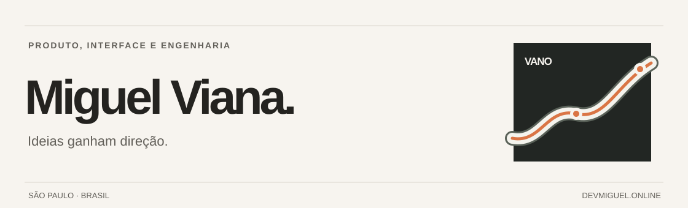

  

  <a href="https://devmiguel.online">Portfólio</a> ·
  <a href="https://vanomaps.online">Vano</a> ·
  <a href="mailto:miguelpinxs@gmail.com">Contato</a>

Sou **Miguel Viana**, desenvolvedor full stack em São Paulo. Construo produtos digitais da interface à operação, com atenção ao uso real, aos dados e à arquitetura que sustenta cada experiência.

## Em foco: Vano

O **[Vano](https://vanomaps.online)** é meu produto de navegação. Ele reúne busca de destinos, comparação de rotas, orientação durante o trajeto e contexto da via, incluindo alertas comunitários. A aplicação web está disponível; a experiência Android está em preparação para publicação na Google Play.

Desenvolvo a identidade do produto, a interface, os serviços de rota e o backend. A base combina **Python, Flask, PostgreSQL, JavaScript e Mapbox**.

[Conhecer o produto](https://vanomaps.online) · [Explorar o código](https://github.com/miguel027dev/vano)

## Outros projetos

| Projeto | O que resolve |
| :--- | :--- |
| [TYVON](https://github.com/miguel027dev/tyvon) | Planos de treino por perfil, registro de séries e acompanhamento em web e Android. |
| [Flash Stock](https://github.com/miguel027dev/flashstockpainel) | Loja e catálogo integrados à gestão de produtos, estoque, pedidos e clientes. |
| [Transfer Master](https://github.com/miguel027dev/mastertransfer) | Ferramenta para futebol e scouting com interface React e backend de autenticação. |
| [La Cantine Portugaise](https://miguel027dev.github.io/la-cantine-portugaise/) | Conceito independente e não oficial de site para cardápio, localização e reservas. |
| [BRASA 91](https://devmiguel.online/live/brasa91/index.html) · [Pingo Pet](https://devmiguel.online/live/pingo-pet/index.html) | Demonstrações navegáveis de sites comerciais. |

## Como trabalho

Começo pelo fluxo que a pessoa precisa completar. Construo interface, APIs e dados como partes da mesma experiência. Depois do primeiro deploy, volto à legibilidade, ao desempenho e aos detalhes que aparecem no uso.

**Interface:** HTML, CSS, JavaScript e React.  
**Serviços e dados:** Python, Flask, APIs, PostgreSQL e SQLite.  
**Produto e operação:** Mapas, integrações, testes, Git e Render.

Veja o [portfólio completo](https://devmiguel.online) ou escreva para **[miguelpinxs@gmail.com](mailto:miguelpinxs@gmail.com)**.
